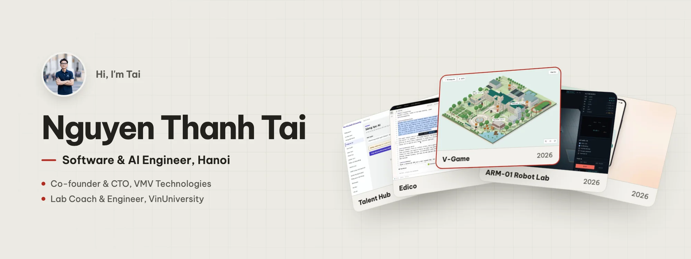
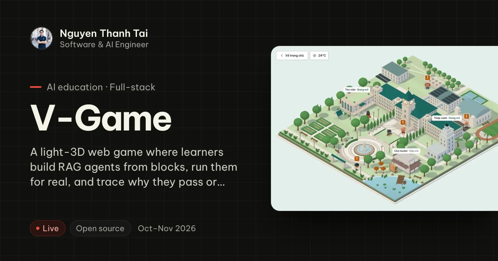
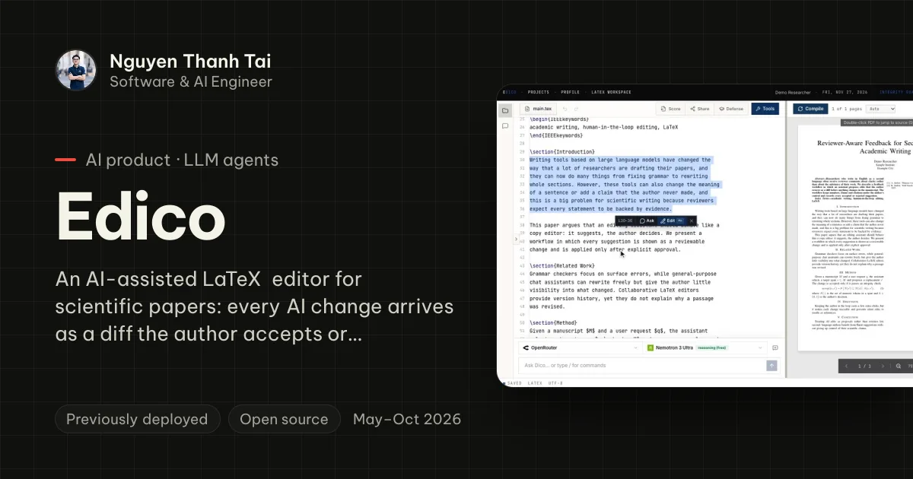
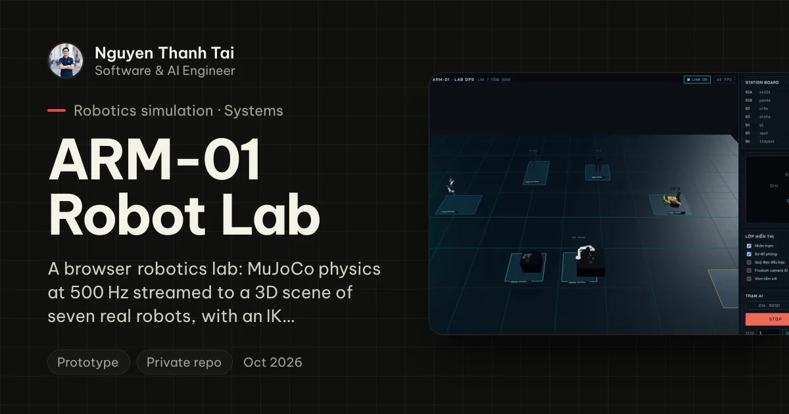
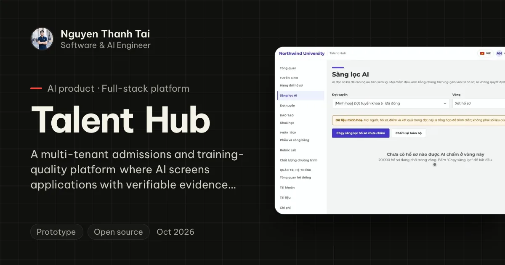
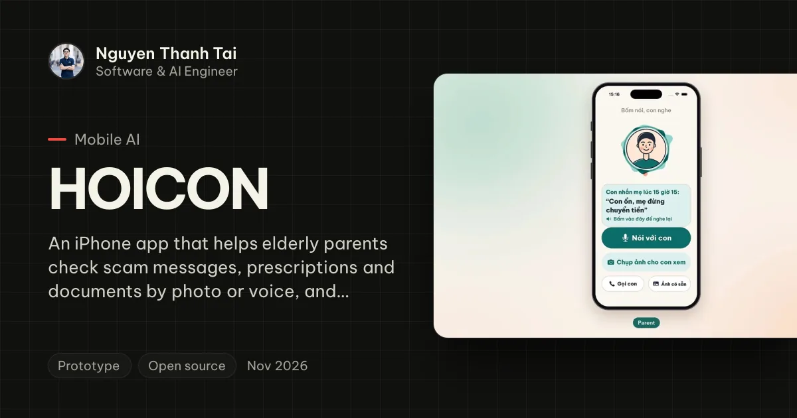

<picture>
    <source media="(prefers-color-scheme: dark)" srcset="assets/profile/banner-dark.webp">
    
  </picture>

  <a href="https://taithanh.ai20k.cloud"><b>Portfolio</b></a> &nbsp;·&nbsp;
  <a href="https://taithanh.ai20k.cloud/vi">Tiếng Việt</a> &nbsp;·&nbsp;
  <a href="https://taithanh.ai20k.cloud/cv/Nguyen-Thanh-Tai-CV.pdf">CV</a> &nbsp;·&nbsp;
  <a href="https://www.linkedin.com/in/se-nttai/">LinkedIn</a> &nbsp;·&nbsp;
  <a href="mailto:n.t.tai435@gmail.com">n.t.tai435@gmail.com</a>

I build software end to end, from AI pipelines and APIs to the interfaces people use, and I ship it with tests and guardrails. I co-founded VMV Technologies, where I lead technology as CTO, and I work as a Lab Coach & Engineer in VinUniversity's AI20K program.

### Selected work

<table>
  <tr>
    <td colspan="2">
      
      
<a href="https://taithanh.ai20k.cloud/projects/v-game"><b>Case study</b></a> &nbsp;·&nbsp; <a href="https://vgame.ai20k.cloud">Play the live game</a> &nbsp;·&nbsp; <a href="https://github.com/Tai-TZ/v-game">Source</a>

    </td>
  </tr>
  <tr>
    <td width="50%">
      
      
<a href="https://taithanh.ai20k.cloud/projects/edico-ai-paper-editor"><b>Case study</b></a> &nbsp;·&nbsp; <a href="https://github.com/Tai-TZ/edico-ai-paper-editor">Source</a>

    </td>
    <td width="50%">
      
      
<a href="https://taithanh.ai20k.cloud/projects/robot-arm-sim"><b>Case study</b></a> &nbsp;·&nbsp; Private repository

    </td>
  </tr>
  <tr>
    <td width="50%">
      
      
<a href="https://taithanh.ai20k.cloud/projects/talent-hub"><b>Case study</b></a> &nbsp;·&nbsp; <a href="https://github.com/Tai-TZ/talent-hub">Source</a>

    </td>
    <td width="50%">
      
      
<a href="https://taithanh.ai20k.cloud/projects/hoicon"><b>Case study</b></a> &nbsp;·&nbsp; <a href="https://github.com/Tai-TZ/hoicon">Source</a>

    </td>
  </tr>
</table>

### A year of commits, in 3D

<picture>
  <source media="(prefers-color-scheme: dark)" srcset="https://raw.githubusercontent.com/Tai-TZ/Tai-TZ/output/skyline-dark.svg">
  
</picture>

### Toolbox

<table>
  <tr><td width="22%"><b>AI tools</b></td><td>Claude &amp; Claude Code, ChatGPT &amp; Codex, Cursor, Google Antigravity, Kiro, Gemini</td></tr>
  <tr><td><b>AI &amp; LLM</b></td><td>LangGraph, LangChain, RAG (BM25, vector, hybrid + rerank), structured outputs, Claude &amp; Gemini APIs, prompt-injection guards, evaluation sets, PyTorch, OpenCV</td></tr>
  <tr><td><b>Frontend</b></td><td>TypeScript, React 19, Next.js, Angular, Tailwind CSS, three.js / React Three Fiber, React Native (Expo), Zustand, D3.js</td></tr>
  <tr><td><b>Backend &amp; data</b></td><td>Python, FastAPI, Pydantic, SQLAlchemy, PostgreSQL, SQLite, Server-Sent Events / WebSocket, NumPy, Pandas, SciPy</td></tr>
  <tr><td><b>Quality &amp; delivery</b></td><td>pytest, Vitest, Playwright + axe, GitHub Actions, Docker, Vercel, Google Cloud Run, Render, Semgrep, gitleaks</td></tr>
</table>

The skyline is redrawn every 6 hours by <a href=".github/workflows/skyline.yml">a GitHub Action</a> running <a href="scripts/contrib3d.py">scripts/contrib3d.py</a>, in the same palette as <a href="https://taithanh.ai20k.cloud">my portfolio</a>.

<!-- Profile v2, matching the portfolio. v1 (newsprint) is kept in versions/v1.md and tag v1.
     Switch with: cp versions/v1.md README.md (or versions/v2.md), then commit and push. -->
